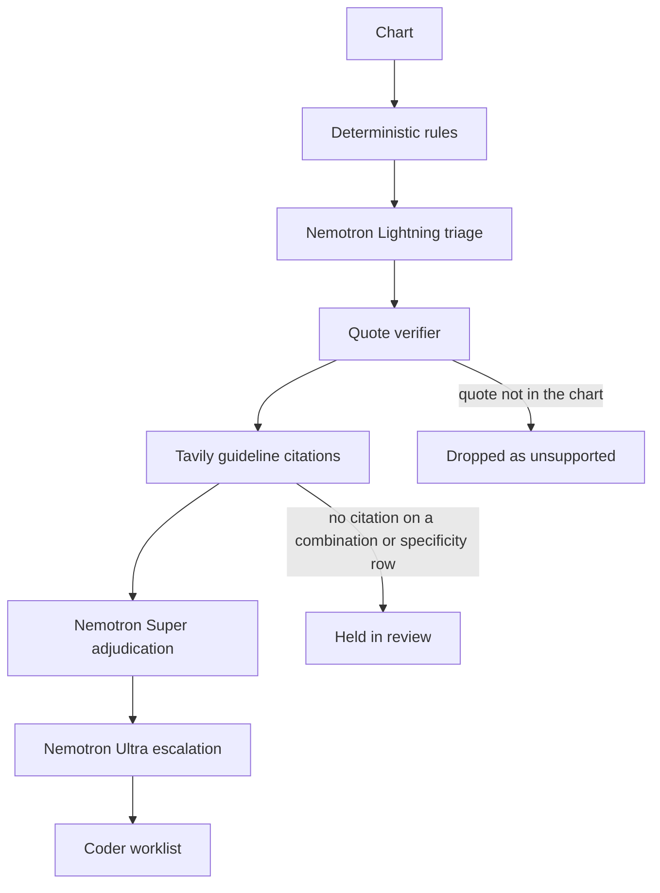

<p align="center">
  <picture>
    <source media="(prefers-color-scheme: dark)" srcset="docs/assets/logo-dark.svg">
    
  </picture>
</p>

<p align="center">
  
</p>

<p align="center">
  <strong>A risk-adjustment coder signs only what the chart and the guideline can defend.</strong>
</p>

<p align="center">
  <a href="https://www.python.org/"></a>
  <a href="LICENSE"></a>
  
  
  
  
</p>

<p align="center">
  
</p>

<p align="center">
  <em>Mock mode, no API keys. The worklist is what a coder would sign.</em>
</p>

CodeSentinel reviews ICD-10-CM diagnosis codes on a clinical chart. Deterministic rules propose missed codes. NVIDIA Nemotron on Nebius Token Factory cross-examines each one. A verifier outside the model drops any quote that is not in the chart. Tavily cites ICD-10-CM guidance for combination-code and specificity decisions, and those decisions stay in review until a citation is attached.

Dollar fields are RAF times a base rate: a relative-weight illustration, not a billing recommendation.

## Why it matters

Risk-adjustment coding pays on the conditions the chart actually supports. An unspecified diabetes or heart-failure code leaves a more specific HCC off the record. A negated diagnosis, a family history, or a screening score can put a code on the record that the note does not support. Either mistake is a queue a coder has to clear by hand.

On the live Gold-B test split (66 charts), the rules queue a coder actually sees (C0+, approved plus review) is **2.000 items per chart**. The full cascade (C4) keeps recall at **1.000** and cuts that queue to **1.242** items per chart, **37.9%** less review, at about **$0.0014** per chart.

## How it works

`gap_pipeline.py` proposes candidates. `codesentinel.nemotron.cascade` decides what is shown. C1 stops after triage and the quote verifier. C2 adds Super. C3 adds the guideline lookup. C4 adds Ultra.



| Step | Model | What it does |
|---|---|---|
| Triage | `nvidia/Nemotron-3_5-Lightning` | One structured JSON call per candidate. Temperature 0, thinking off. Falls back to `nvidia/NVIDIA-Nemotron-3-Nano-30B-A3B` when Lightning is absent from a live `models.list()`. |
| Adjudication | `nvidia/nemotron-3-super-120b-a12b` | Medium-confidence survivors, plus every specificity upgrade and combination code. Temperature 0.6, thinking on. |
| Escalation and physician query | `nvidia/Nemotron-3-Ultra-550b-a55b` | Conflicts, high-value HCC upgrades (RAF at least 0.3), and non-leading physician queries. |
| Quote verifier | none | A supporting quote must be a whitespace-normalized substring of the note (at least 12 characters), an exact lab or medication line, or a structured record id. Anything else is `unsupported`. |
| Guidelines | Tavily | Official ICD-10-CM guideline text outranks other CMS pages. A code printed next to the wrong title is rejected. A secondary page is kept only when the titles match, and the API labels it `Secondary source`. No accepted passage means no citation. |

Calls use `POST /chat/completions` on `https://api.tokenfactory.nebius.com/v1/` with `response_format.type = json_schema`. A bad JSON payload gets one repair retry, then the candidate is held for review. Every audit returns a receipt: model, calls, tokens, latency, and catalog cost.

<details>
<summary>Two more walks through the demo</summary>

<p align="center">
  
</p>

<p align="center"><em>Evidence for E11.22. Mock mode labels the citation as a fixture and shows the source tier of that URL.</em></p>

<p align="center">
  
</p>

<p align="center"><em>The coder accepts or dismisses. Nothing is submitted. The Eval tab reads <code>eval/results/summary.json</code>.</em></p>

</details>

## Features

- Four rule tiers: lab thresholds, phenotype patterns, note patterns with a negation and screening window, then specificity upgrades and combination codes.
- Nemotron cascade with a depth switch: C1 triage, C2 Super, C3 guidelines, C4 Ultra.
- Quote verifier that the model cannot override.
- Guideline gate: combination and specificity rows stay in `review` until a citation is attached.
- Source tier on every live or cached citation: `Official guidelines` or `Secondary source`. Mislabeled code lists are dropped.
- Receipt per audit, plus `POST /audit` contract 1.0.0 and an MCP endpoint.
- PHI patterns (SSN, MRN, email, US phone) are refused before a note is sent.
- Mock mode with the keys unset, so the demo and the test suite run offline.

## Live results

Live run on gold sets. C1–C4 called Token Factory. These are not mock scores. The numbers below are from the live run of commit cfaee89 on 2026-10-27. Citations quote curated, verbatim sections of the FY2026 ICD-10-CM Official Guidelines; for E11.65 and I50 specificity they cite the closest official rule text, since the guidelines have no code-specific sentence for those. Guideline citations come from curated sections of the official FY2026 guidelines; Tavily confirms the source live.

**Gold-B test, 66 FHIR charts, seed 20261024.** C0 is the rules approved bucket. C0+ is approved plus review, the queue a coder sees. The comparison that matters is C4 against C0+.

| Config | Precision | Recall | F1 | TP | FP | FN | Review / chart | $ / chart |
|---|---:|---:|---:|---:|---:|---:|---:|---:|
| C0 | 0.697 | 0.785 | 0.738 | 62 | 27 | 17 | 1.348 | 0.00000 |
| C0+ | 0.598 | 1.000 | 0.749 | 79 | 53 | 0 | 2.000 | 0.00000 |
| C1 | 0.975 | 1.000 | 0.988 | 79 | 2 | 0 | 1.273 | 0.00020 |
| C2 | 0.975 | 1.000 | 0.988 | 79 | 2 | 0 | 1.273 | 0.00044 |
| C3 | 1.000 | 1.000 | 1.000 | 79 | 0 | 0 | 1.242 | 0.00049 |
| C4 | 1.000 | 1.000 | 1.000 | 79 | 0 | 0 | 1.242 | 0.00136 |

C4 review burden is 37.9% lower than C0+ (2.000 to 1.242) with recall held at 1.000. Catalog cost is $0.00136 per chart, about $0.0014. C4 latency on that run was P50 2.18 s and P95 14.90 s.

**Gold-A, 10 hand-labeled charts.** Not the headline benchmark. A human coder has not signed those labels (`review_status` in [eval/gold/gold_a.json](eval/gold/gold_a.json)). Live C4: precision **0.872**, recall **0.919**, F1 **0.895**.

**Unsupported existing codes, Gold-B C4:** 3 true positives, 0 false positives, 0 false negatives (3/3).

<details>
<summary>Hard negatives, stability, and what this run does not claim</summary>

C4 hard-negative pass rate on Gold-B test was 1.000 in every category in that run: `acute_not_chronic` 3/3, `copied_forward` 2/2, `cross_sentence_negation` 3/3, `family_history` 2/2, `hypothetical_plan` 5/5, `medication_only` 20/20, `negation` 7/7, `resolved` 2/2, `screening` 2/2, `unspecified_sibling` 5/5, `wrong_specificity` 2/2.

Two live C4 passes agreed on 0.970 of charts (64 of 66; same shown code and decision set). One chart in C2 (gb-0050) ran degraded after a Super adjudication call returned HTTP 529; no C4 chart was degraded.

Published Gold-A misses from that run include `pt-001` false negatives `D64.9` and `I12.9`, and `pt-004` false negative `I50.9`. The harness lists a sample, not every miss.

Gold-B labels were written by construction, by the same author as the offline policy. The policy does not read the labels. Held-out means the test charts were not used to edit prompts.

The file checked in at [eval/RESULTS.md](eval/RESULTS.md) is the mock harness write-up. A live command overwrites it. Do not quote the mock table as Token Factory or Tavily quality. The schema is [docs/eval.md](docs/eval.md). MTSamples has no gold labels here, so it is not a precision number.

</details>

## Quickstart

Python 3.12. Keys are optional. Leave both blank for the recorded client.

```bash
git clone https://github.com/kishanraj41/codesentinel.git
cd codesentinel
python -m venv .venv
.venv\Scripts\activate          # Windows
# source .venv/bin/activate     # macOS / Linux
pip install -r requirements.txt
copy .env.example .env          # Windows
# cp .env.example .env          # macOS / Linux
python mcp_server.py
```

```bash
curl http://localhost:8000/health
curl http://localhost:8000/patients
curl -X POST http://localhost:8000/audit -H "Content-Type: application/json" -d "{\"patient_id\":\"pt-001\"}"
```

| Variable | Role |
|---|---|
| `NEBIUS_API_KEY` | Token Factory. Empty runs the recorded Nemotron client (`mode: mock`). |
| `NEBIUS_BASE_URL` | Default `https://api.tokenfactory.nebius.com/v1/`. |
| `TAVILY_API_KEY` | Confirms the official FY2026 guideline PDF and fills codes with no curated section. Empty skips that check; curated sections are still cited. |
| `GUIDELINE_CACHE_DIR` | Disk cache for Tavily extracts. Default `.cache/guidelines`. |

With both keys unset, curated guideline sections are still cited. Fixture quotes for codes without an anchor are labeled and are not live official excerpts. Set both keys for Token Factory and Tavily.

Web demo, from `web/`:

```bash
pip install -r requirements.txt
uvicorn app.main:app --port 8080
```

Open http://localhost:8080, choose **Margaret Whitmore**, and click **Audit chart**. With `AUDIT_API_BASE` unset, that call stays in-process and the cascade runs in mock mode. See [web/README.md](web/README.md).

Eval:

```bash
python -m eval.run --split test --mode mock
python -m eval.run --split test --mode live    # requires both API keys
```

Tests:

```bash
python -m unittest discover -s tests
python -m unittest eval.tests.test_harness
python -m pytest web/tests/test_app.py -q
python run_tests.py
```

<details>
<summary>Project structure</summary>

```text
mcp_server.py            POST /audit and the MCP endpoint
gap_pipeline.py          Rule tiers that propose candidates
codesentinel/nemotron/   Lightning, Super, Ultra cascade
codesentinel/tavily/     Guideline search, extract, and citation checks
codesentinel/policy.py   Production checks. The server does not import eval/
eval/                    Gold sets, harness, and mock or live runner
web/                     Judge demo (Audit and Eval tabs)
docs/api.md              Audit contract 1.0.0
docs/eval.md             Metrics schema
docs/assets/             Logo, banner, and demo GIFs
```

`agents/` remains in the tree and is not imported by the server.

</details>

## API

`POST /audit` is contract 1.0.0. The field list, citation object (`source_tier`, `source_label`), and the guideline gate are in [docs/api.md](docs/api.md).

`POST /mcp` exposes `detect_coding_gaps`, `get_patient_summary`, `validate_gap`, `list_detected_gaps`, and `draft_physician_query`. `detect_coding_gaps` runs the same verified pipeline as `POST /audit`. Point an MCP client at `http://localhost:8000/mcp`. `python mock_fhir_server.py` serves patients `synth-001`, `synth-002`, and `synth-003` on port 9090.

## Safety and limitations

- Demo and evaluation charts are generated test records; CodeSentinel is a reviewer aid, not medical advice.
- `POST /audit` refuses SSN-like, MRN-like, email, and US phone patterns.
- A person decides. Accept and dismiss stay on the coder. This does not submit a claim.
- Combination and specificity rows without a guideline citation stay in review.
- English, outpatient-style notes. The regex tiers miss paraphrases the recorded client will not invent.
- No claim of HIPAA compliance. A production chart with PHI would need Zero Data Retention, a dedicated endpoint, and the right agreements.
- `MAX_DAILY_USD` is documented in [.env.example](.env.example) and is not enforced on the audit service yet.
- Gold-A is 10 charts pending coder sign-off. Gold-B was built around the same phenomena as the offline policy.

<details>
<summary>Roadmap</summary>

- Re-run live eval after the round-3 citation filter and publish the shifted Gold-B and Gold-A rows beside this table.
- Prefer official guideline rule text in the demo cache, so the evidence panel can show an official excerpt instead of a fixture pointer.
- Enforce the daily dollar cap on the audit service.
- Coder sign-off on Gold-A (`review_status`).
- Keep MTSamples as a queue count until it has labels.

</details>

## License

MIT. See [LICENSE](LICENSE).

## Acknowledgments

NVIDIA Nemotron on Nebius Token Factory for triage, adjudication, and escalation. Tavily for guideline retrieval. CMS and CDC publish the ICD-10-CM pages the citations point at.

## Project history

CodeSentinel evolved from an earlier prototype (snapshot 2026-05-07); see [docs/changes.md](docs/changes.md) for what was rebuilt during the Nebius hackathon window.
