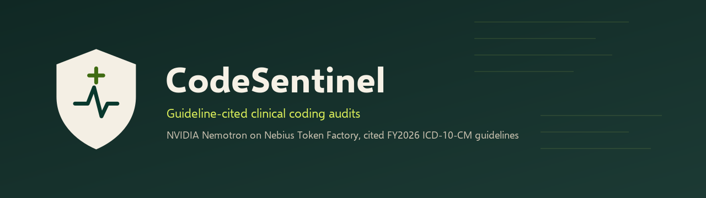
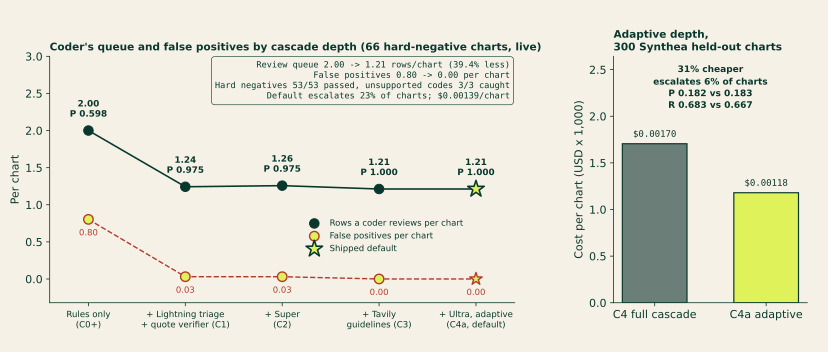
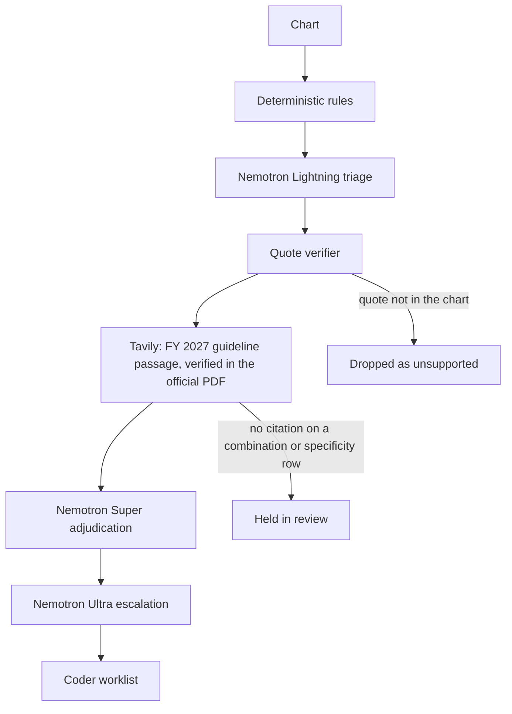

<p align="center">
  <picture>
    <source media="(prefers-color-scheme: dark)" srcset="docs/assets/logo-dark.svg">
    
  </picture>
</p>

<p align="center">
  
</p>

<h1 align="center">CodeSentinel: guideline-cited clinical coding audits on NVIDIA Nemotron</h1>

<p align="center">
  <strong>A risk-adjustment coder signs only what the chart and the ICD-10-CM guideline can defend.</strong><br>
  Runs on <strong>Nebius Token Factory</strong>: <code>nvidia/Nemotron-3_5-Lightning</code> triage, <code>nvidia/nemotron-3-super-120b-a12b</code> adjudication, <code>nvidia/Nemotron-3-Ultra-550b-a55b</code> escalation.
</p>

<p align="center">
  <a href="https://www.python.org/"></a>
  <a href="LICENSE"></a>
  
  
  
  
</p>

<p align="center">
  
</p>

<p align="center">
  <em>Live on Nebius Token Factory (the wait while the cascade runs is sped up). The worklist a coder signs: each row carries the chart quote and the Nemotron decision, and combination and specificity rows carry the guideline citation.</em>
</p>

CodeSentinel audits outpatient clinical charts for ICD-10-CM and HCC coding gaps. Deterministic rules propose missed or under-specified codes. A three-model NVIDIA Nemotron cascade on Nebius Token Factory cross-examines each one. A verifier outside the model drops any quote that is not in the chart. Tavily retrieves the passage of the current ICD-10-CM Official Guidelines (FY 2027, in force since 2026-10-01) for each combination-code and specificity decision, and the passage is cited only if it matches the official CMS PDF verbatim. Those decisions stay in review until a guideline citation is attached.

This is clinical coding integrity, not software security: the "code" is a diagnosis code.

**Live demo:** [codesentinel-bno0.onrender.com](https://codesentinel-bno0.onrender.com) (Render free tier; the first request after idle takes about a minute to wake). Inference runs on Nebius Token Factory.

## Results

<!-- RESULTS:BEGIN. Every number in this block is from eval/results/live-v9/ (summary.json for Gold-B, gold_a_summary.json for Gold-A) and eval/results/synthea/heldout-v9/summary.json, all run live on commit 8ab01be on 2026-10-28. Swap the whole block when a newer run is published. -->

**CodeSentinel cuts a risk-adjustment coder's review queue 39.4% at 1.000 precision on hard negatives, and sends only the charts that need it to Super and Ultra.**

All three evaluations ran live on Nebius Token Factory on 2026-10-28, on the shipped commit `8ab01be`. Each compares C4a, the adaptive cascade the service runs by default, with C0+, the rules queue a coder sees today (approved plus review).

| Set | Charts | What it measures | Result, C4a vs the rules queue |
|---|---:|---|---|
| Hard-negative suite | 66 | The 11 ways a chart fools a coder: negation, family history, screening, medication-only, copied-forward, hypothetical plan, resolved, cross-sentence negation, acute-not-chronic, unspecified sibling, wrong specificity | Precision 0.598 → 1.000 at recall 0.975, review queue −39.4% (2.00 → 1.21 rows/chart), 11/11 categories, 3/3 unsupported billed codes caught, $0.0014/chart |
| Hand-labeled charts | 10 | Outpatient notes labeled by hand | Precision 0.755 → 0.897 at recall 0.946, queue 4.9 → 4.2 rows/chart |
| Synthea held-out | 300 | Independently generated records (MITRE Synthea v4.0.0); the author wrote no chart or label | Gap-row false positives −72% (656 → 184), gap rows per chart 2.35 → 0.75, 20/20 planted unsupported codes caught, 31% cheaper per chart than the full cascade |

<p align="center">
  
</p>

Most of the gain comes at the first step: Lightning triage plus the quote verifier (C1) removes 96% of the rules' false positives on the hard-negative suite (53 → 2). Super alone (C2) holds precision at 0.975; with the retrieved guideline passage in its prompt (C3), precision reaches 1.000. Ultra settles disagreements and high-value upgrades and drafts the physician query. Adaptive depth sends a chart up the cascade only when the rules propose a combination or specificity code: 23% of hard-negative charts, 50% of hand-labeled charts and 6% of Synthea charts went past Lightning. C4a matched or beat the full cascade C4 on both hand-built sets, and on Synthea it found one more gold gap with five more false-positive rows (precision 0.182 vs 0.183, recall 0.683 vs 0.667) at 31% lower cost ($0.00170 → $0.00118 per chart). Every guideline citation in these runs is a Tavily-retrieved FY 2027 passage verified verbatim in the CMS PDF.

Synthea fixes were designed on a committed 100-chart dev split. Held-out has been run once per code version and this is the run on the final code; the earlier held-out runs are kept, with the history in [eval/synthea/README.md](eval/synthea/README.md). Results: [eval/results/synthea/heldout-v9/RESULTS.md](eval/results/synthea/heldout-v9/RESULTS.md).

Full tables for every config (C0 to C4 and C4a), confidence intervals, hard-negative categories and known misses: [eval/results/live-v9/RESULTS.md](eval/results/live-v9/RESULTS.md).

<details>
<summary>What these numbers do not show</summary>

- Each config is a separate live pass, so small differences between depths include live-model variance. Two live C4 passes agreed on 63 of 66 hard-negative charts.
- Fixed C4 slipped on one hard negative in this run (gb-0051 shows I50.9; precision 0.987). C4a passed it. C4a's two misses are the I12.9 on gb-0042 and the J44.1 on gb-0063; C4 misses the I12.9 on gb-0041 and gb-0042.
- On the hard-negative suite C4a costs about the same as C4 ($0.00139 vs $0.00136 per chart); the adaptive saving shows on Synthea. On the hand-labeled set it is $0.00613 vs $0.00657.
- The Tavily gate rule itself overrode no decision in these runs; its job is that no combination or specificity row is accepted without a verified citation. v9 served the Tavily search results from the on-disk result cache (0 new credits); each passage was re-verified against the PDF.
- On Synthea the rules queue has higher recall (0.817 vs 0.683), and the unsupported-billed-code check adds about three flags per chart on codes Synthea does have (912 in total), because the thin template charts never mention them. Total review items are 3.86 per chart against 2.35 for the rules queue.
- Gold-A is ten charts whose labels await certified-coder sign-off. Gold-B charts and labels are author-constructed around known traps, so it is a regression suite, not an independent benchmark.

</details>

<!-- RESULTS:END -->

Cost is reported Token Factory usage times the public catalog price. `eval/results/mock/` holds offline regression output from the recorded client; those numbers are not model quality. The schema is in [docs/eval.md](docs/eval.md).

## Why it matters

Risk-adjustment coding pays on the conditions the chart actually supports. An unspecified diabetes or heart-failure code leaves a more specific HCC off the record. A negated diagnosis, a family history, or a screening score can put a code on the record that the note does not support. Either mistake is a queue a coder has to clear by hand. CodeSentinel shortens that queue and attaches the chart quote and the guideline text a coder needs to sign each row.

## How it works

`gap_pipeline.py` proposes candidates. `codesentinel.nemotron.cascade` decides what is shown. C1 stops after triage and the quote verifier. C2 adds Super. C3 adds the guideline lookup. C4 adds Ultra.

C4a, the service default, picks the depth per chart from the rules candidates, before triage runs. If the rules propose any combination or specificity code, the whole chart runs the full C4 path, and every such candidate goes to Super and the Tavily guideline lookup, then to Ultra on a disagreement or an upgrade worth RAF 0.3 or more, whatever triage said and however confident it was. A candidate that triage would have dropped still needs a verbatim chart quote, and if the models accept it the row is held as review, never accepted. A chart with no such candidate stops after triage and the verifier: rows triage keeps at confidence 0.8 or higher are accepted, lower-confidence rows are held as review, and rows triage drops (negated, family history, screening and the like) are not shown.



| Step | Model | What it does |
|---|---|---|
| Triage | `nvidia/Nemotron-3_5-Lightning` | One structured JSON call per candidate. Temperature 0, thinking off. If a live `models.list()` ever omits Lightning, triage falls back to `nvidia/NVIDIA-Nemotron-3-Nano-30B-A3B`. |
| Adjudication | `nvidia/nemotron-3-super-120b-a12b` | Medium-confidence survivors, plus every specificity upgrade and combination code. Temperature 0.6, thinking on. |
| Escalation and physician query | `nvidia/Nemotron-3-Ultra-550b-a55b` | Conflicts, high-value HCC upgrades (RAF at least 0.3), and non-leading physician queries. |
| Quote verifier | none | A supporting quote must be a whitespace-normalized substring of the note (at least 12 characters), an exact lab or medication line, or a structured record id. Anything else is `unsupported`. |
| Guidelines | Tavily | One search per code family, restricted to cms.gov and cdc.gov, for the current edition of the ICD-10-CM Official Guidelines. A passage is cited only if it is verbatim in the official PDF fetched that run; page and section come from the PDF. Curated sections are the fallback and the cross-check. No verified passage means no citation. |

### Guideline citations

Every citation records where it came from:

| Field | Example |
|---|---|
| `provenance` | `tavily_live` (Tavily found it, verified in the PDF) or `curated_fallback` |
| `fiscal_year`, `url` | `FY 2027`, `https://www.cms.gov/files/document/fy-2027-icd-10-cm-coding-guidelines.pdf` |
| `section`, `page` | `I.C.9.a.2`, `50` |
| `verified_verbatim`, `pdf_sha256` | `true`, the SHA-256 of the PDF it was matched in |
| `anchor_status` | `verified`, or `superseded` when the curated section is no longer in the current edition |

The edition is picked from the run date, and FY 2027 (in force from 2026-10-01) is registered with its CMS URL and SHA-256. The six curated passages (sections I.A.15, I.C.4.a, I.C.9.a.2, I.C.9.a.3 twice, I.C.14.a.1) were re-extracted from the FY 2027 PDF and are word-for-word unchanged from FY 2026, on the same pages. If a future edition rewrites one, the curated passage is marked `superseded` and never cited; the gate decides on the live passage, or holds the row in review if none verifies. Tavily results are cached per run, so each code family costs one search.

Calls use `POST /chat/completions` on `https://api.tokenfactory.nebius.com/v1/` with `response_format.type = json_schema`. A bad JSON payload gets one repair retry, then the candidate is held for review. Every audit returns a receipt: model, calls, tokens, latency, and catalog cost.

Model ids are checked against Token Factory at startup. A live `GET /v1/models` on 2026-10-27 returned these Nemotron ids, and the client uses the first four with this exact casing:

```text
nvidia/Nemotron-3_5-Lightning
nvidia/nemotron-3-super-120b-a12b
nvidia/Nemotron-3-Ultra-550b-a55b
nvidia/NVIDIA-Nemotron-3-Nano-30B-A3B
nvidia/Nemotron-3.5-Super-VL
```

<details>
<summary>Two more walks through the demo</summary>

<p align="center">
  
</p>

<p align="center"><em>Evidence for E11.22: the chart quote, the guideline citation, and its source tier.</em></p>

<p align="center">
  
</p>

<p align="center"><em>The coder accepts or dismisses. Nothing is submitted. The Eval tab reads <code>eval/results/live-v9/summary.json</code>.</em></p>

</details>

## Features

- Four rule tiers: lab thresholds, phenotype patterns, note patterns with a negation and screening window, then specificity upgrades and combination codes.
- Nemotron cascade with a depth switch: C1 triage, C2 Super, C3 guidelines, C4 Ultra, and C4a, the default, which runs the full C4 path only on charts with a combination or specificity candidate.
- Quote verifier that the model cannot override.
- Guideline gate: combination and specificity rows stay in `review` until a citation is attached.
- Source tier on every citation: `Official guidelines` or `Secondary source`. Mislabeled code lists are dropped.
- Receipt per audit, plus `POST /audit` contract 1.0.0 and an MCP endpoint.
- PHI patterns (SSN, MRN, email, US phone) are refused before a note is sent.
- Recorded client with the keys unset, so the test suite and local development run offline.

## Quickstart

Python 3.12. Keys are optional. Leave both blank for the recorded client.

```bash
git clone https://github.com/kishanraj41/codesentinel.git
cd codesentinel
python -m venv .venv
.venv\Scripts\activate          # Windows
# source .venv/bin/activate     # macOS / Linux
pip install -r requirements.txt
copy .env.example .env          # Windows
# cp .env.example .env          # macOS / Linux
python mcp_server.py
```

```bash
curl http://localhost:8000/health
curl http://localhost:8000/patients
curl -X POST http://localhost:8000/audit -H "Content-Type: application/json" -d "{\"patient_id\":\"pt-001\"}"
```

| Variable | Role |
|---|---|
| `NEBIUS_API_KEY` | Token Factory. Empty runs the recorded Nemotron client (`mode: mock`). |
| `NEBIUS_BASE_URL` | Default `https://api.tokenfactory.nebius.com/v1/`. |
| `TAVILY_API_KEY` | Live guideline retrieval for the current fiscal year, verified against the official PDF. Empty cites the curated sections only. |
| `GUIDELINE_FISCAL_YEAR` | Optional. Pin the guideline edition, for example `2026`. Default: the fiscal year of the run date. |
| `GUIDELINE_CACHE_DIR` | Per-run cache for Tavily results and the extracted guideline PDF text. Default `.cache/guidelines`. |

With both keys unset, curated guideline sections are still cited. Set both keys for Token Factory and Tavily.

Web demo, from `web/`:

```bash
pip install -r requirements.txt
uvicorn app.main:app --port 8080
```

Open http://localhost:8080, choose **Margaret Whitmore**, and click **Audit chart**. With `AUDIT_API_BASE` unset, that call stays in-process and the cascade runs in mock mode. See [web/README.md](web/README.md). The hosted demo is the `Dockerfile.web` image on Render's free tier; see [docs/DEPLOY.md](docs/DEPLOY.md).

Eval:

```bash
python -m eval.run --split test --mode mock    # writes eval/results/mock/
python -m eval.run --split test --mode live    # writes eval/results/live/, requires both API keys
# The published v9 run: EVAL_OUT_DIR=eval/results/live-v9 python -m eval.run --split test --mode live
```

Tests (run with the keys unset so nothing calls the network):

```bash
python -m unittest discover -s tests
python -m unittest eval.tests.test_harness eval.tests.test_synthea
python -m pytest web/tests -q
python run_tests.py
```

<details>
<summary>Project structure</summary>

```text
mcp_server.py            POST /audit and the MCP endpoint
gap_pipeline.py          Rule tiers that propose candidates
codesentinel/nemotron/   Lightning, Super, Ultra cascade
codesentinel/tavily/     Guideline search, extract, and citation checks
codesentinel/guidelines/ Guideline editions, PDF verifier, curated sections
codesentinel/policy.py   Production checks. The server does not import eval/
eval/                    Gold sets, harness, and mock or live runner
eval/results/live-v9/    Published live run (v9, commit 8ab01be): summaries and RESULTS.md
eval/results/live/       Earlier live run (v7) with recorded completions; v8 is in live-v8/
eval/results/mock/       Offline regression output
eval/synthea/            Synthea benchmark: generator command, SNOMED to ICD-10-CM map, builder, runner
eval/results/synthea/    Synthea runs: heldout-v9/ (headline), earlier held-out v1 and heldout-v2/, dev/, dev-v2/, pre-fix baseline-v0/, labels, chart hashes
web/                     Judge demo (Audit and Eval tabs)
docs/api.md              Audit contract 1.0.0
docs/eval.md             Metrics schema
docs/assets/             Logo, banner, demo GIFs, and the frontier charts
```

</details>

## API

`POST /audit` is contract 1.0.0. The field list, citation object (`source_tier`, `source_label`), and the guideline gate are in [docs/api.md](docs/api.md).

`POST /mcp` exposes `detect_coding_gaps`, `get_patient_summary`, `validate_gap`, `list_detected_gaps`, and `draft_physician_query`. `detect_coding_gaps` runs the same verified pipeline as `POST /audit`. Point an MCP client at `http://localhost:8000/mcp`. `python mock_fhir_server.py` serves patients `synth-001`, `synth-002`, and `synth-003` on port 9090.

Dollar fields are RAF times a base rate: a relative-weight illustration, not a billing recommendation.

## Safety and limitations

- Data: demo and evaluation charts are generated test records, not real patients. CodeSentinel is a reviewer aid, not medical advice.
- Evaluation sets are small or generated; per-set caveats, confidence intervals and known misses are in [eval/results/live-v9/RESULTS.md](eval/results/live-v9/RESULTS.md) and [eval/results/synthea/heldout-v9/RESULTS.md](eval/results/synthea/heldout-v9/RESULTS.md).
- `POST /audit` refuses SSN-like, MRN-like, email, and US phone patterns.
- A person decides. Accept and dismiss stay on the coder. This does not submit a claim.
- Combination and specificity rows without a guideline citation stay in review.
- English, outpatient-style notes. The regex tiers miss paraphrases the recorded client will not invent.
- No claim of HIPAA compliance. A production deployment would need Zero Data Retention, a dedicated endpoint, and the right agreements.
- `MAX_DAILY_USD` is documented in [.env.example](.env.example) and is not enforced on the audit service yet.

<details>
<summary>Roadmap</summary>

- Certified-coder sign-off on Gold-A, then grow it past ten charts.
- Enforce the daily dollar cap on the audit service.
- Keep MTSamples as a queue count until it has labels.

</details>

## License

MIT. See [LICENSE](LICENSE).

## Acknowledgments and third-party services

NVIDIA Nemotron on Nebius Token Factory for triage, adjudication, and escalation. Tavily for guideline retrieval. CMS and CDC publish the ICD-10-CM Official Guidelines the citations quote. [Synthea](https://github.com/synthetichealth/synthea) (MITRE) generates the benchmark patients, mapped with the NLM SNOMED CT to ICD-10-CM Map. The demo is hosted on Render.

## Project history

Rebuilt from a May 2026 prototype (Ctrl+Alt+Heal). New during the hackathon window: Nemotron cascade with adaptive depth (C4a), quote verifier, Tavily FY2027 guideline gate, API contract, eval harness, Synthea benchmark. Details: [docs/changes.md](docs/changes.md).
