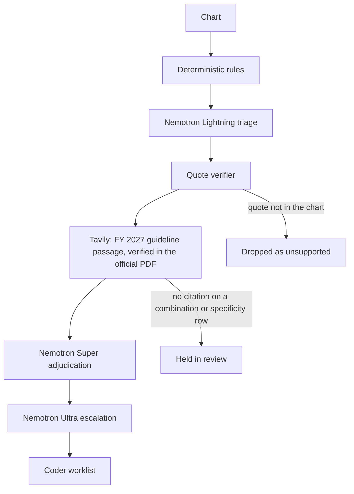

<p align="center">
  <picture>
    <source media="(prefers-color-scheme: dark)" srcset="docs/assets/logo-dark.svg">
    
  </picture>
</p>

<p align="center">
  
</p>

<h1 align="center">CodeSentinel: guideline-cited clinical coding audits on NVIDIA Nemotron</h1>

<p align="center">
  <strong>A risk-adjustment coder signs only what the chart and the ICD-10-CM guideline can defend.</strong><br>
  Runs on <strong>Nebius Token Factory</strong>: <code>nvidia/Nemotron-3_5-Lightning</code> triage, <code>nvidia/nemotron-3-super-120b-a12b</code> adjudication, <code>nvidia/Nemotron-3-Ultra-550b-a55b</code> escalation.
</p>

<p align="center">
  <a href="https://www.python.org/"></a>
  <a href="LICENSE"></a>
  
  
  
  
</p>

<p align="center">
  
</p>

<p align="center">
  <em>Mock mode, no API keys. The worklist is what a coder would sign.</em>
</p>

CodeSentinel audits outpatient clinical charts for ICD-10-CM and HCC coding gaps. Deterministic rules propose missed or under-specified codes. A three-model NVIDIA Nemotron cascade on Nebius Token Factory cross-examines each one. A verifier outside the model drops any quote that is not in the chart. Tavily retrieves the passage of the current ICD-10-CM Official Guidelines (FY 2027, in force since 2026-10-01) for each combination-code and specificity decision, and the passage is cited only if it matches the official CMS PDF verbatim. Those decisions stay in review until a guideline citation is attached.

This is clinical coding integrity, not software security: the "code" is a diagnosis code.

**Live demo:** `<DEMO_URL>` (Render free tier; the first request after idle takes about a minute to wake). Inference runs on Nebius Token Factory.

## Results

Three evaluation sets, all run live on Nebius Token Factory on 2026-10-27, with FY 2027 guideline citations retrieved through Tavily. C0+ is the rules queue a coder sees today (approved plus review). C4 is the full cascade.

| Set | Charts | Config | Precision | Recall | F1 | Review items / chart | $ / chart | P50 / P95 s |
|---|---:|---|---:|---:|---:|---:|---:|---:|
| **Synthea held-out** (outside generator, 60 gold gaps) | 300 | C0+ rules | 0.070 | 0.817 | 0.128 | 2.35 | 0 | — |
| | | C4 cascade | 0.183 | 0.667 | 0.288 | 3.83 (0.73 gap rows) | 0.0018 | 4.7 / 19.0 |
| **Gold-A** (hand-labeled) | 10 | C0+ rules | 0.755 | 1.000 | 0.860 | 4.90 | 0 | — |
| | | C4 cascade | 0.868 | 0.892 | 0.880 | 4.10 | 0.0074 | 14.5 / 35.4 |
| Gold-B (hard-negative and regression suite) | 66 | C0+ rules | 0.598 | 1.000 | 0.749 | 2.00 | 0 | — |
| | | C4 cascade | 1.000 | 0.987 | 0.994 | 1.23 | 0.0014 | 2.0 / 18.3 |

**An independent benchmark exposed three bugs; they were fixed on a dev split, and the headline is the held-out result.** The patients come from [Synthea](https://github.com/synthetichealth/synthea) v4.0.0 (seed `20261027`, Texas, ages 45–90), so neither the charts nor the labels were written by the author. Each patient's active Synthea conditions are mapped to ICD-10-CM with the NLM SNOMED CT to ICD-10-CM map and the FY 2027 combination-code rules. A seeded 30% of the billed codes CodeSentinel covers are removed from the chart, and the removed codes the 12-month chart still supports (a note, a linked medication, or a lab meeting a published criterion) are the gold gaps. Method and reproduction: [eval/synthea/README.md](eval/synthea/README.md). Full results: [eval/results/synthea/RESULTS.md](eval/results/synthea/RESULTS.md).

The first run on all 400 charts was poor: C4 recall 0.027. It showed three bugs. Triage dropped medication-supported gaps as `copied_forward_unclear` (56 of 75) instead of sending them to review, because the rescue for medication evidence only fired on empty notes and Synthea notes are template text. Triage saw only the first 40 structured lines, which hid the medication list on 103 charts. And the unsupported-existing check flagged 1,962 billed codes Synthea does have, because it only knew terms for a short code list and ignored linked medications and labs. The 400 patients were then split by seed into 100 dev and 300 held-out charts, and the split was committed before any fix. The fixes, plus a blood-glucose LOINC that had been mapped to glycosuria and an R73 Excludes1 rule, were made and checked on dev only (dev C4 recall 0.067 to 0.933). The held-out charts were run once afterwards.

On held-out, C4 recall is 0.667 (95% CI 0.54–0.77), up from 0.017 before the fixes, with precision 0.183 against 0.070 for the rules queue. It is still weaker than dev, and it is reported that way: 8 held-out gaps were still dropped as `copied_forward_unclear`, and most false positives are statin and ACE-inhibitor rows that the medication policy sends to review (Synthea prescribes both for prevention). The two-way check found 19 of 20 planted unsupported codes. It still flags about three billed codes per chart, because the 12-month chart has no mention, linked medication or lab for many chronic conditions.

<p align="center">
  
</p>

**Gold-A** is ten outpatient charts labeled by hand, with labels pending certified-coder sign-off (`review_status` in [eval/gold/gold_a.json](eval/gold/gold_a.json)). Ten charts give wide intervals (C4 precision 95% CI 0.73–0.94, recall 0.75–0.96). C4 raises precision from 0.755 to 0.868 and cuts the queue from 4.9 to 4.1 items per chart, at the cost of four missed codes (`D64.9` and `I12.9` on pt-001, `I12.9` and `I50.9` on pt-004). The previous run (v6, before the Synthea fixes) had C4 at 0.872 / 0.919. Source: [eval/results/live/RESULTS.md](eval/results/live/RESULTS.md), commit `b623d53`.

**Gold-B is a regression suite, not a benchmark.** The charts were built by the same author as the rules, around known traps. It answers one question: does the cascade still clear the hard negatives? On this run C4 passed all 11 categories (negation, family history, screening, medication-only, hypothetical plan, resolved, copied-forward, cross-sentence negation, acute-not-chronic, unspecified sibling, wrong specificity), flagged 3/3 unsupported existing codes, and cut review burden 38.6% against C0+ (2.00 to 1.23) at $0.00136 per chart. It missed one combination code (`I12.9` on gb-0042) that v6 found. Two live C4 passes agreed on 65 of 66 charts. No chart was degraded, and every C3/C4 guideline citation was retrieved live and verified in the FY 2027 PDF.

Cost is reported Token Factory usage times the public catalog price. `eval/results/mock/` holds offline regression output from the recorded client; those numbers are not model quality. The schema is in [docs/eval.md](docs/eval.md).

## Why it matters

Risk-adjustment coding pays on the conditions the chart actually supports. An unspecified diabetes or heart-failure code leaves a more specific HCC off the record. A negated diagnosis, a family history, or a screening score can put a code on the record that the note does not support. Either mistake is a queue a coder has to clear by hand. CodeSentinel shortens that queue and attaches the chart quote and the guideline text a coder needs to sign each row.

## How it works

`gap_pipeline.py` proposes candidates. `codesentinel.nemotron.cascade` decides what is shown. C1 stops after triage and the quote verifier. C2 adds Super. C3 adds the guideline lookup. C4 adds Ultra.



| Step | Model | What it does |
|---|---|---|
| Triage | `nvidia/Nemotron-3_5-Lightning` | One structured JSON call per candidate. Temperature 0, thinking off. If a live `models.list()` ever omits Lightning, triage falls back to `nvidia/NVIDIA-Nemotron-3-Nano-30B-A3B`. |
| Adjudication | `nvidia/nemotron-3-super-120b-a12b` | Medium-confidence survivors, plus every specificity upgrade and combination code. Temperature 0.6, thinking on. |
| Escalation and physician query | `nvidia/Nemotron-3-Ultra-550b-a55b` | Conflicts, high-value HCC upgrades (RAF at least 0.3), and non-leading physician queries. |
| Quote verifier | none | A supporting quote must be a whitespace-normalized substring of the note (at least 12 characters), an exact lab or medication line, or a structured record id. Anything else is `unsupported`. |
| Guidelines | Tavily | One search per code family, restricted to cms.gov and cdc.gov, for the current edition of the ICD-10-CM Official Guidelines. A passage is cited only if it is verbatim in the official PDF fetched that run; page and section come from the PDF. Curated sections are the fallback and the cross-check. No verified passage means no citation. |

### Guideline citations

Every citation records where it came from:

| Field | Example |
|---|---|
| `provenance` | `tavily_live` (Tavily found it, verified in the PDF) or `curated_fallback` |
| `fiscal_year`, `url` | `FY 2027`, `https://www.cms.gov/files/document/fy-2027-icd-10-cm-coding-guidelines.pdf` |
| `section`, `page` | `I.C.9.a.2`, `50` |
| `verified_verbatim`, `pdf_sha256` | `true`, the SHA-256 of the PDF it was matched in |
| `anchor_status` | `verified`, or `superseded` when the curated section is no longer in the current edition |

The edition is picked from the run date, and FY 2027 (in force from 2026-10-01) is registered with its CMS URL and SHA-256. The six curated passages (sections I.A.15, I.C.4.a, I.C.9.a.2, I.C.9.a.3 twice, I.C.14.a.1) were re-extracted from the FY 2027 PDF and are word-for-word unchanged from FY 2026, on the same pages. If a future edition rewrites one, the curated passage is marked `superseded` and never cited; the gate decides on the live passage, or holds the row in review if none verifies. Tavily results are cached per run, so each code family costs one search.

Calls use `POST /chat/completions` on `https://api.tokenfactory.nebius.com/v1/` with `response_format.type = json_schema`. A bad JSON payload gets one repair retry, then the candidate is held for review. Every audit returns a receipt: model, calls, tokens, latency, and catalog cost.

Model ids are checked against Token Factory at startup. A live `GET /v1/models` on 2026-10-27 returned these Nemotron ids, and the client uses the first four with this exact casing:

```text
nvidia/Nemotron-3_5-Lightning
nvidia/nemotron-3-super-120b-a12b
nvidia/Nemotron-3-Ultra-550b-a55b
nvidia/NVIDIA-Nemotron-3-Nano-30B-A3B
nvidia/Nemotron-3.5-Super-VL
```

<details>
<summary>Two more walks through the demo</summary>

<p align="center">
  
</p>

<p align="center"><em>Evidence for E11.22: the chart quote, the guideline citation, and its source tier.</em></p>

<p align="center">
  
</p>

<p align="center"><em>The coder accepts or dismisses. Nothing is submitted. The Eval tab reads <code>eval/results/live/summary.json</code>.</em></p>

</details>

## Features

- Four rule tiers: lab thresholds, phenotype patterns, note patterns with a negation and screening window, then specificity upgrades and combination codes.
- Nemotron cascade with a depth switch: C1 triage, C2 Super, C3 guidelines, C4 Ultra.
- Quote verifier that the model cannot override.
- Guideline gate: combination and specificity rows stay in `review` until a citation is attached.
- Source tier on every citation: `Official guidelines` or `Secondary source`. Mislabeled code lists are dropped.
- Receipt per audit, plus `POST /audit` contract 1.0.0 and an MCP endpoint.
- PHI patterns (SSN, MRN, email, US phone) are refused before a note is sent.
- Mock mode with the keys unset, so the demo and the test suite run offline.

## Quickstart

Python 3.12. Keys are optional. Leave both blank for the recorded client.

```bash
git clone https://github.com/kishanraj41/codesentinel.git
cd codesentinel
python -m venv .venv
.venv\Scripts\activate          # Windows
# source .venv/bin/activate     # macOS / Linux
pip install -r requirements.txt
copy .env.example .env          # Windows
# cp .env.example .env          # macOS / Linux
python mcp_server.py
```

```bash
curl http://localhost:8000/health
curl http://localhost:8000/patients
curl -X POST http://localhost:8000/audit -H "Content-Type: application/json" -d "{\"patient_id\":\"pt-001\"}"
```

| Variable | Role |
|---|---|
| `NEBIUS_API_KEY` | Token Factory. Empty runs the recorded Nemotron client (`mode: mock`). |
| `NEBIUS_BASE_URL` | Default `https://api.tokenfactory.nebius.com/v1/`. |
| `TAVILY_API_KEY` | Live guideline retrieval for the current fiscal year, verified against the official PDF. Empty cites the curated sections only. |
| `GUIDELINE_FISCAL_YEAR` | Optional. Pin the guideline edition, for example `2026`. Default: the fiscal year of the run date. |
| `GUIDELINE_CACHE_DIR` | Per-run cache for Tavily results and the extracted guideline PDF text. Default `.cache/guidelines`. |

With both keys unset, curated guideline sections are still cited. Set both keys for Token Factory and Tavily.

Web demo, from `web/`:

```bash
pip install -r requirements.txt
uvicorn app.main:app --port 8080
```

Open http://localhost:8080, choose **Margaret Whitmore**, and click **Audit chart**. With `AUDIT_API_BASE` unset, that call stays in-process and the cascade runs in mock mode. See [web/README.md](web/README.md). The hosted demo is the `Dockerfile.web` image on Render's free tier; see [docs/DEPLOY.md](docs/DEPLOY.md).

Eval:

```bash
python -m eval.run --split test --mode mock    # writes eval/results/mock/
python -m eval.run --split test --mode live    # writes eval/results/live/, requires both API keys
```

Tests (run with the keys unset so nothing calls the network):

```bash
python -m unittest discover -s tests
python -m unittest eval.tests.test_harness eval.tests.test_synthea
python -m pytest web/tests -q
python run_tests.py
```

<details>
<summary>Project structure</summary>

```text
mcp_server.py            POST /audit and the MCP endpoint
gap_pipeline.py          Rule tiers that propose candidates
codesentinel/nemotron/   Lightning, Super, Ultra cascade
codesentinel/tavily/     Guideline search, extract, and citation checks
codesentinel/guidelines/ Guideline editions, PDF verifier, curated sections
codesentinel/policy.py   Production checks. The server does not import eval/
eval/                    Gold sets, harness, and mock or live runner
eval/results/live/       Published live run: summary, RESULTS.md, recorded completions
eval/results/mock/       Offline regression output
eval/synthea/            Synthea benchmark: generator command, SNOMED to ICD-10-CM map, builder, runner
eval/results/synthea/    Synthea held-out run (headline), dev/ and pre-fix baseline-v0/, labels, chart hashes
web/                     Judge demo (Audit and Eval tabs)
docs/api.md              Audit contract 1.0.0
docs/eval.md             Metrics schema
docs/assets/             Logo, banner, and demo GIFs
```

</details>

## API

`POST /audit` is contract 1.0.0. The field list, citation object (`source_tier`, `source_label`), and the guideline gate are in [docs/api.md](docs/api.md).

`POST /mcp` exposes `detect_coding_gaps`, `get_patient_summary`, `validate_gap`, `list_detected_gaps`, and `draft_physician_query`. `detect_coding_gaps` runs the same verified pipeline as `POST /audit`. Point an MCP client at `http://localhost:8000/mcp`. `python mock_fhir_server.py` serves patients `synth-001`, `synth-002`, and `synth-003` on port 9090.

Dollar fields are RAF times a base rate: a relative-weight illustration, not a billing recommendation.

## Safety and limitations

- Demo and evaluation charts are generated test records; CodeSentinel is a reviewer aid, not medical advice.
- `POST /audit` refuses SSN-like, MRN-like, email, and US phone patterns.
- A person decides. Accept and dismiss stay on the coder. This does not submit a claim.
- Combination and specificity rows without a guideline citation stay in review.
- English, outpatient-style notes. The regex tiers miss paraphrases the recorded client will not invent.
- No claim of HIPAA compliance. A production deployment would need Zero Data Retention, a dedicated endpoint, and the right agreements.
- `MAX_DAILY_USD` is documented in [.env.example](.env.example) and is not enforced on the audit service yet.
- On the Synthea held-out split C4 recall is 0.667 and precision 0.183, and the two-way check still flags about three billed codes per chart; see Results. Synthea labels are derived by code, not reviewed by a coder.
- Gold-A is 10 charts pending coder sign-off. Gold-B was built around the same phenomena as the rules, so it is a regression suite rather than an independent benchmark.

<details>
<summary>Roadmap</summary>

- Certified-coder sign-off on Gold-A, then grow it past ten charts.
- Enforce the daily dollar cap on the audit service.
- Keep MTSamples as a queue count until it has labels.

</details>

## License

MIT. See [LICENSE](LICENSE).

## Acknowledgments

NVIDIA Nemotron on Nebius Token Factory for triage, adjudication, and escalation. Tavily for guideline retrieval. CMS and CDC publish the ICD-10-CM Official Guidelines the citations quote.

## Project history

CodeSentinel evolved from Ctrl+Alt+Heal, Kishan's earlier hackathon project (snapshot 2026-05-07); see [docs/changes.md](docs/changes.md) for what was rebuilt during the Nebius hackathon window.
