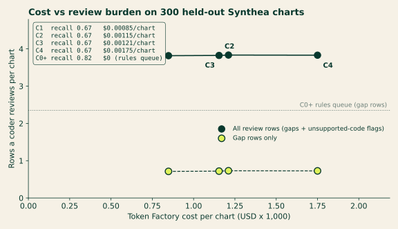

# Synthea gap benchmark

An outside benchmark for CodeSentinel's gap finding. The patients, conditions, labs,
medications and notes come from [Synthea](https://github.com/synthetichealth/synthea), MITRE's
open-source patient simulator. The author wrote no chart content and no per-chart label. Labels
are derived by code from Synthea's own condition list.

Results: [eval/results/synthea/RESULTS.md](../results/synthea/RESULTS.md) (held-out, the headline), [dev/](../results/synthea/dev/RESULTS.md) and the pre-fix [baseline-v0/](../results/synthea/baseline-v0/RESULTS.md).

## How a chart and its label are made

1. **Generate.** Synthea v4.0.0, 400 living adults aged 45–90 in Texas, seed `20261027`
   (clinician seed `20261027`), reference date 2026-10-27, 10 years of history, FHIR R4 export
   (`generate.sh`).
2. **Map.** Every active Synthea condition is mapped from SNOMED CT to ICD-10-CM with
   `snomed_icd10cm.csv`. Each row names its source: NLM I-MAGIC, which runs the
   [NLM SNOMED CT to ICD-10-CM Map](https://www.nlm.nih.gov/research/umls/mapping_projects/snomedct_to_icd10cm.html)
   (release 20260901), with the query URL that reproduces it. `imagic_lookup.py` is the lookup script.
3. **Combine.** Combination codes follow the FY 2027 ICD-10-CM Official Guidelines and Tabular
   List: rules R1–R8 in `build.py` (diabetes with CKD, diabetes with hyperglycemia, R73 excludes,
   E11.9 only without complications, hypertension with CKD / heart failure / both, one CKD stage).
   The result is the patient's billed code list.
4. **Make gaps.** The in-scope codes are the ones CodeSentinel's rules can propose: `E11.9`,
   `E11.22`, `E11.65`, `N18.30`, `N18.4`, `I10`, `I12.9`, `I50.9`, `E78.5`, `E78.1`, `D64.9`, `F32.9`.
   A seeded 30% of in-scope (patient, code) pairs are removed from the chart's Condition list.
   Every other code stays billed.
5. **Check support.** The chart is the last 12 months: lab results (up to 3 per LOINC), active or
   recent medications, the 3 latest notes, and encounters. A removed code is a gold gap only if
   that chart still supports it: a note names the condition, a medication has a Synthea
   `reasonReference` to it, or the latest lab meets a published criterion (ADA, KDIGO, NCEP ATP III,
   WHO; listed in the generated `manifest.json`). A combination code needs both parts supported.
   Removed codes without support are neutral: a shown row for one is not counted either way.
6. **Hard negatives.** About 8% of charts (seeded) get one extra billed code from a category the
   patient's Synthea record does not have. Those are scored as unsupported existing codes.
7. **Read.** Each chart is read by `fhir_adapter.FHIRPatientExtractor`, the production FHIR
   adapter, through an in-memory FHIR client (`BundleFHIRClient` in `run.py`).

Scoring is the same item-level scorer as Gold-A and Gold-B (`eval/score.py`), with two
adjustments in `run.py`: a shown code that is the dotted parent of a label code counts as that
code (CodeSentinel writes `N18.3`; the FY 2027 billable code is `N18.30`), and neutral rows are
removed before scoring.

## Frontier chart

Review rows per chart against Token Factory cost per chart for C1 to C4 on the 300 held-out charts,
with recall for each configuration ([synthea-frontier.png](../../docs/assets/synthea-frontier.png)):

<p align="center">
  
</p>

## Reproduce

```bash
# 1. Synthea (Java 17+). Writes synthea-out/fhir/*.json, about 2.2 GB.
eval/synthea/generate.sh synthea-out

# 2. Charts and labels. Writes BENCH/bundles/, BENCH/labels.jsonl, BENCH/manifest.json.
python -m eval.synthea.build --synthea-dir synthea-out/fhir --out BENCH --seed 20261027

# 3. Live run (both keys set). --split dev|held_out reads split.json; --limit 20 is the smoke subset.
python -m eval.synthea.run --bench BENCH --out eval/results/synthea --mode live --split held_out --workers 5

# 4. Frontier chart (needs matplotlib).
python -m eval.synthea.frontier eval/results/synthea/summary.json docs/assets/synthea-frontier
```

`eval/results/synthea/manifest.json` records the SHA-256 of every chart bundle the published run
used, so a rebuilt benchmark can be checked chart by chart.

## Dev / held-out protocol

From the project README (moved here verbatim):

The first run on all 400 charts was poor: C4 recall 0.027. It showed three bugs. Triage dropped medication-supported gaps as `copied_forward_unclear` (56 of 75) instead of sending them to review, because the rescue for medication evidence only fired on empty notes and Synthea notes are template text. Triage saw only the first 40 structured lines, which hid the medication list on 103 charts. And the unsupported-existing check flagged 1,962 billed codes Synthea does have, because it only knew terms for a short code list and ignored linked medications and labs. The 400 patients were then split by seed into 100 dev and 300 held-out charts, and the split was committed before any fix. The fixes, plus a blood-glucose LOINC that had been mapped to glycosuria and an R73 Excludes1 rule, were made and checked on dev only (dev C4 recall 0.067 to 0.933). The held-out charts were run once afterwards.

On held-out, C4 recall is 0.667 (95% CI 0.54–0.77), up from 0.017 before the fixes, with precision 0.183 against 0.070 for the rules queue. It is still weaker than dev, and it is reported that way: 8 held-out gaps were still dropped as `copied_forward_unclear`, and most false positives are statin and ACE-inhibitor rows that the medication policy sends to review (Synthea prescribes both for prevention). The two-way check found 19 of 20 planted unsupported codes. It still flags about three billed codes per chart, because the 12-month chart has no mention, linked medication or lab for many chronic conditions.

The first full run (all 400 charts, before any change) exposed three cascade bugs. They were
fixed under a split fixed in advance, so the published number is on charts the fixes never saw.

1. **Split first.** `split.json` assigns the 400 patient ids with `random.Random(20261028)` over the
   sorted ids: the first 100 are `dev`, the other 300 `held_out`. It was committed (`ebf1f9c`)
   before any cascade change.
2. **Fix on dev only.** Bugs were diagnosed from dev charts and from the dev rows of the first
   run. Held-out per-chart outcomes were not opened while fixing. The live iteration runs were
   `--split dev` only.
3. **One held-out run.** After the fixes were committed, the 300 held-out charts were run once
   with every configuration (`--split held_out`). No change was made after that run.
4. **Benchmark unchanged.** `labels.jsonl` and the chart bundles are the ones from the first
   run (manifest SHA-256s unchanged). No label was edited.

Known exposure before the split: the aggregate 400-chart results and a handful of smoke-run
charts (which can include held-out patients) had been read while writing up the first run.
No fix was designed from a specific held-out chart.

Post-run fix: carvedilol and furosemide were removed from the heart-failure (`I50`) drug list in
`codesentinel/policy.py`, because they excused a planted unsupported `I50.9`. Found on held-out after the single held-out run; fixed afterward. Held-out numbers are from before this fix and were not rerun.
The same two drugs were then removed from the `I13` (hypertensive heart and chronic kidney disease) list,
so they no longer excuse an `I13` code on their own either; also not rerun.

```bash
python -m eval.synthea.run --bench BENCH --out OUT_DEV --mode live --split dev
python -m eval.synthea.run --bench BENCH --out OUT_HELD --mode live --split held_out
```

## Limits

- One planted unsupported code (`I50.9`) on held-out was excused by carvedilol, which the unsupported-existing fix counted as a heart-failure drug even though the triage policy treats it as nonspecific. Found on held-out after the single held-out run; fixed afterward. Held-out numbers are from before this fix and were not rerun.

- Synthea notes are template text. They rarely name the chronic conditions, so evidence is mostly
  medications and labs.
- Gold gaps are mostly `E78.5` and `I10`. Diabetes, CKD and combination-code gaps are few.
- Labels are derived by code from Synthea's condition list. No certified coder reviewed them.
